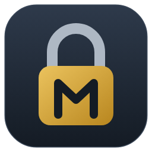
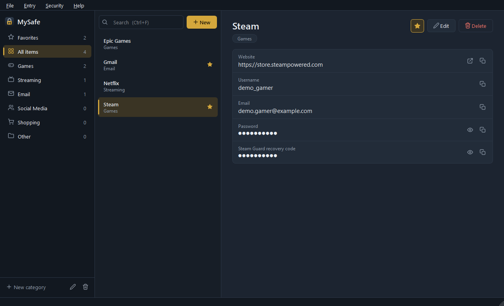
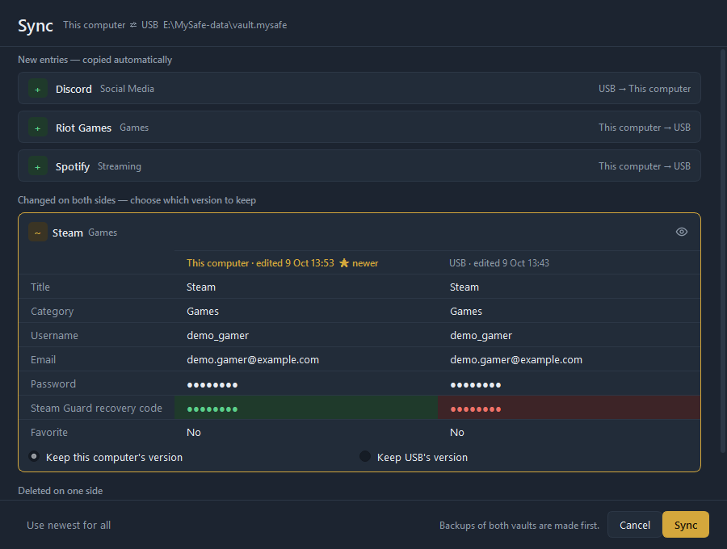
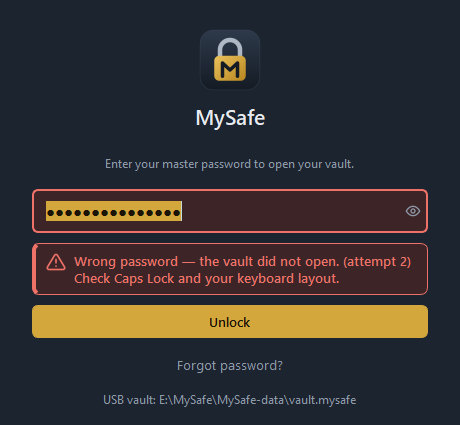
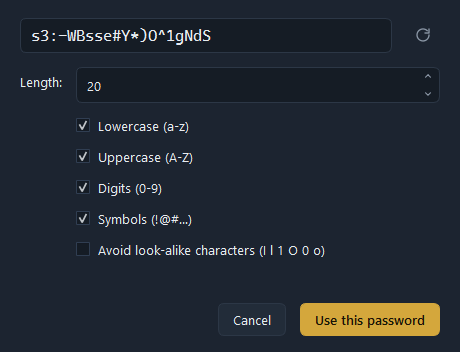

<p align="center">
  
</p>

<h1 align="center">MySafe</h1>

<p align="center">
  A simple, open-source password manager for <b>Windows</b> and <b>Linux</b> —<br>
  works from your computer <b>and</b> from a USB stick, and keeps both copies in sync.
</p>

<p align="center">
  <a href="../../releases/latest"><b>Download</b></a> ·
  <a href="docs/USER_GUIDE.md">User guide</a> ·
  <a href="SECURITY.md">Security</a> ·
  <a href="docs/ARCHITECTURE.md">Architecture</a>
</p>



MySafe keeps all your account details — emails, usernames, passwords, recovery codes,
security questions — in **one encrypted file** instead of scattered text files and notes.
No account, no cloud, no internet connection: your data stays on your computer and your
USB stick.

## Features

- **Categories** (Games, Streaming, Email, Social Media, Shopping, …) — one level, no sub-folders
- **Entries with any fields you like**: email, username, password, recovery code,
  security question, notes… each with your own label ("Steam Guard recovery code")
- **Search**, favorites, one-click **copy** (copied secrets are cleared from the clipboard
  automatically and kept out of Windows clipboard history), show/hide
- **Password generator** and an optional **naming guide** (`Service – Account`, e.g. `Gmail – Work`)
- **Light / dark** theme
- **Master password + recovery key** (shown once — write it on paper)
- **Lock** with Ctrl+L, optional **auto-lock** when idle
- **USB copy and Sync**
  - new entries are copied automatically,
  - an entry changed on both sides is shown **side by side** (like a GitHub diff) and you pick
    which version to keep — or "Use newest for all",
  - a deletion is marked in red with a "Delete on … too" checkbox,
  - both vaults are backed up before every sync.
- **Restore from backup** — undo a sync or a mistake
- One single program file, nothing to install

| Sync | Lock screen | Password generator |
|---|---|---|
|  |  |  |

## Download and start

1. Download from the [latest release](../../releases/latest):
   - **Windows:** `MySafe.exe`
   - **Linux:** `MySafe-linux-x86_64` (make it executable: `chmod +x MySafe-linux-x86_64`)
2. Optional but recommended: check the file against the `.sha256` file next to it
   (Windows PowerShell: `Get-FileHash MySafe.exe`).
3. Start it, choose a master password, and **write down the recovery key** it shows you.

> **Windows SmartScreen** may say "Windows protected your PC", because the program is not
> code-signed yet. Click **More info → Run anyway**. The first start takes a few seconds
> (the single file unpacks itself).

**USB stick:** in MySafe choose **File → Create USB copy…** and pick the stick. MySafe puts an
encrypted copy of your vault (`MySafe-data` folder) *and* the program on the stick. On any
other computer, open `MySafe.exe` from the stick. Back home, **File → Sync** brings both
copies up to date.

Everything else — categories, fields, sync, backups, forgotten passwords — is explained in the
**[user guide](docs/USER_GUIDE.md)**.

## Where your data is

| | |
|---|---|
| Windows | `%APPDATA%\MySafe\vault.mysafe` |
| Linux | `~/.local/share/MySafe/vault.mysafe` |
| USB stick | `MySafe-data\vault.mysafe` next to `MySafe.exe` |

Next to the vault MySafe keeps encrypted backups: `vault.mysafe.bak` (previous save),
`vault.mysafe.before-sync` and `vault.mysafe.before-restore`.

## Security in short

| | |
|---|---|
| Encryption | The whole database is encrypted with **AES-256-GCM** (`cryptography` library). |
| Master password | Stretched with **Argon2id** (64 MiB memory, 3 passes), so every guess is slow and expensive. |
| Recovery key | 160 random bits, written as 8 groups (`XXXX-XXXX-…`). Opens the vault if you forget the password; you then choose a new one. |
| Changing the password | Also switches to a **new encryption key** and re-encrypts the backups, so an old password stops working everywhere (a USB copy follows at the next sync). |
| Sync | A copy can never change your master password unless you type *that copy's* password. |
| In memory only | The decrypted database never touches the disk. |
| Safe saving | Atomic writes, a backup of the previous version, files readable only by you on Linux. |

**MySafe cannot protect you from** malware or a keylogger on a computer while MySafe is
unlocked, from a weak master password, or from losing **both** the master password and
the recovery key — then the data is gone for good; nobody (including the authors) can
recover it. More details: [SECURITY.md](SECURITY.md).

> MySafe is young and has not had an independent security audit yet.

## Building from source

Requires **Python 3.11+**.

```bash
python -m venv .venv
# Windows: .venv\Scripts\activate      Linux: source .venv/bin/activate
pip install -e ".[dev]"
python -m mysafe          # run
pytest                    # tests
ruff check . && ruff format --check . && mypy mysafe

pip install -e ".[build]"
python tools/build.py     # -> dist/MySafe.exe (or dist/MySafe-linux-x86_64) + .sha256
```

The build starts the finished program once with `--self-check` (bundled files, database,
encryption) and fails if anything is missing. On Windows, `dev_run.bat`, `dev_test.bat` and
`build.bat` do the same inside `.venv`.

Every push is tested on Windows and Linux by GitHub Actions; pushing a tag such as `v0.1.0`
builds both programs and publishes them as a release.

## Contributing

Bug reports and ideas are welcome in [Issues](../../issues). Please **do not** report
security problems publicly — see [SECURITY.md](SECURITY.md).

## License

MySafe is free software: you can redistribute it and/or modify it under the terms of the
**GNU General Public License v3.0 or later** — see [LICENSE](LICENSE).
It is distributed in the hope that it will be useful, but **without any warranty**.
