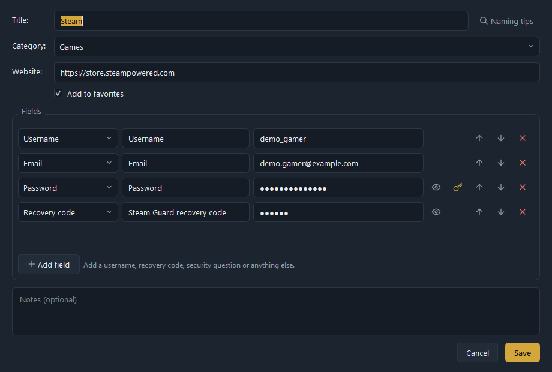
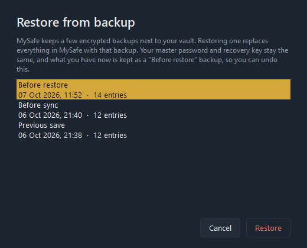
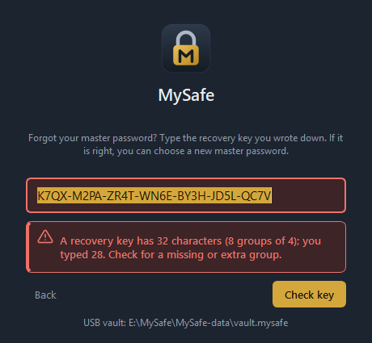

# MySafe user guide

MySafe keeps your account details in one encrypted file. This guide covers everything from
the first start to USB sync and backups. Menu names are written like **File → Sync**.

- [1. First start](#1-first-start)
- [2. Everyday use](#2-everyday-use)
- [3. Naming entries](#3-naming-entries)
- [4. Locking](#4-locking)
- [5. Using a USB stick](#5-using-a-usb-stick)
- [6. Sync](#6-sync)
- [7. Backups and Restore](#7-backups-and-restore)
- [8. Forgot your master password?](#8-forgot-your-master-password)
- [9. Changing the password or recovery key](#9-changing-the-password-or-recovery-key)
- [10. Settings](#10-settings)
- [11. Keyboard shortcuts](#11-keyboard-shortcuts)
- [12. Questions and answers](#12-questions-and-answers)

---

## 1. First start

1. Start `MySafe.exe` (Linux: `MySafe-linux-x86_64`).
2. **Choose a master password.** It must be at least 10 characters, and either 12+
   characters long or a mix of letters, digits and symbols. A short sentence you can
   remember works well, e.g. `Blue bicycle 1987 summer!`.
3. Tick "I understand…" and click **Create vault**.
4. MySafe shows your **recovery key** — 8 groups of 4 characters, e.g. `K7QX-M2PA-…`.
   **Write it on paper** and keep it somewhere safe at home, *not* on the computer or the
   USB stick. It is shown only once. It is the only way back in if you forget the master
   password.

MySafe starts with the categories Games, Streaming, Email, Social Media, Shopping and Other.

## 2. Everyday use

The window has three columns: **categories** on the left, **entries** in the middle and the
selected entry's **details** on the right.

**Add an entry:** click **+ New** (Ctrl+N). Give it a title, choose a category and add
fields. Every field has a label you choose and a type:

| Type | Used for | Hidden? |
|---|---|---|
| Email, Username, Text | logins and other details | no |
| Password | passwords | yes (●●●) |
| Recovery code | backup codes, e.g. Steam Guard | yes |
| Security question | "Favorite color?" → answer | yes |
| URL | a web address | no |
| Note | longer text | no |

- The key button next to a password field fills in a strong generated password (the
  generator is also under File → Password generator…, Ctrl+G). If the field already has a
  password, MySafe asks before replacing it.
- Each entry can also have a **website**; the open button next to it opens the page in
  your browser.
- **Save changes** lists what you changed and asks for confirmation. Nothing is saved
  if nothing changed.
- Everything you save is written to the encrypted file immediately — there is no "Save"
  button for the whole vault.

**Copy** a value with the copy button next to it. Passwords and other hidden values are
removed from the clipboard again after 20 seconds (see [Settings](#10-settings)), when you
lock MySafe, and when you quit. On Windows they are also kept out of clipboard history
(Win+V).

**Show** a hidden value with the eye button. **Search** (Ctrl+F) finds entries by title,
website, email, username and URL fields — never by passwords, codes or answers.

**Favorites:** click the star on an entry. **Categories:** add one with "+ New category"
at the bottom left; rename or delete it with the buttons next to it. When you delete a
category that still has entries, MySafe asks which category to move them to.

## 3. Naming entries

Help → **Naming guide** (F1) suggests a simple formula that keeps search easy:
**`Service – Account`**, for example `Gmail – Personal`, `Gmail – Work`, `Steam – main`.
It is only a suggestion; you can name entries any way you like.

## 4. Locking

- **Security → Lock now** (Ctrl+L) closes everything and wipes the key from memory. Enter
  the master password to continue.
- **Auto-lock** (off by default): File → Settings → "Lock when idle for". When the time is
  up MySafe locks even if a window is open (unsaved edits in that window are discarded).
- **Wrong password:** a red message shows how many attempts were wrong. After 5 wrong
  attempts in a row you have to wait 5 seconds, then 10, 15… up to 30 seconds per attempt.

## 5. Using a USB stick

1. On your computer: **File → Create USB copy…** and choose the stick (for example `E:\`).
2. MySafe writes `E:\MySafe-data\vault.mysafe` (your encrypted vault) and — when you run
   the downloaded program — `E:\MySafe.exe`.
3. On another computer, open `E:\MySafe.exe`. It finds `MySafe-data` next to itself and
   opens the USB vault (the status bar says "USB vault"). Same master password.
4. Back home, plug the stick in and use **File → Sync** (on the computer or on the stick).

Tip: you can also keep the USB copy in any folder (e.g. a cloud-synced folder) — choose that
folder instead of the stick.

## 6. Sync

**File → Sync** (Ctrl+Shift+S) compares this vault with the other copy and shows what will
happen before anything changes:

| What happened | What Sync does |
|---|---|
| New entry on one side | **Green +** — copied automatically |
| Same entry changed on both sides | Both versions **side by side**; pick which one to keep. The newer one is preselected. **Use newest for all** picks the newer version everywhere. |
| Entry deleted on one side | **Red −** — "Delete on … too" is ticked; untick it to bring the entry back instead |
| Categories added or renamed | Followed automatically |

Click **Sync** to apply. Both vaults are backed up first (`vault.mysafe.before-sync`).

**Master password on both sides.** After a sync both copies open with the same master
password and recovery key:

- If you changed the password on the computer, the USB copy gets the new one.
- If you changed it **on the USB copy**, MySafe asks for the USB copy's password once.
  Only then — and only if that change is the newer one — does the computer switch to it.
  A copy that someone tampered with can therefore never change your password.

## 7. Backups and Restore

MySafe keeps these encrypted backups next to the vault:

| File | What it is |
|---|---|
| `vault.mysafe.bak` | the version before the last save |
| `vault.mysafe.before-sync` | the version before the last sync |
| `vault.mysafe.before-restore` | the version before the last restore |

To go back: **File → Restore from backup…**, choose a backup (date and number of entries
are shown) and click **Restore**.

- Your master password and recovery key stay the same.
- What you had before is kept as "Before restore", so a restore can be undone the same way.
- The USB stick has its own backups: run MySafe from the stick to restore those.

Backups are encrypted like the vault itself. For extra safety you can copy the whole data
folder (see the README) to another drive now and then.

## 8. Forgot your master password?

1. On the lock screen click **Forgot password?**
2. Type your **recovery key** (dashes, spaces and lower case don't matter) and click
   **Check key**. MySafe tells you clearly if the key is wrong or incomplete.
3. When the key is right, choose a **new master password**.
4. MySafe then offers a **new recovery key** — recommended if someone else might have seen
   the old one. You see the new key first; the old one keeps working until you confirm.

If you lose both the master password and the recovery key, the vault cannot be opened by
anyone.

## 9. Changing the password or recovery key

- **Security → Change master password…** — enter the current password and the new one twice.
  Your recovery key keeps working. The backups on this computer are re-encrypted right away
  so the old password no longer opens them; a USB copy follows at the next sync.
- **Security → New recovery key…** — shows a new key. Nothing changes until you tick
  "I have written down…" and click **Use the new key**; **Cancel — keep my old key** leaves
  everything as it was.

## 10. Settings

File → **Settings…** (Ctrl+,):

| Setting | Default |
|---|---|
| Theme | System (follows Windows/Linux), Light or Dark |
| Clear copied secrets after | 20 s ("Never" keeps them until lock/quit) |
| Lock when idle for | Off |

Settings are stored inside the encrypted vault, so the USB copy has its own.

## 11. Keyboard shortcuts

| Shortcut | Action |
|---|---|
| Ctrl+N | New entry |
| Ctrl+Shift+N | New category |
| Ctrl+E | Edit the selected entry |
| Delete | Delete the selected entry (in the entry list) |
| Ctrl+F | Search |
| Ctrl+G | Password generator |
| Ctrl+Shift+S | Sync |
| Ctrl+L | Lock now |
| Ctrl+, | Settings |
| F1 | Naming guide |

## 12. Questions and answers

**Does MySafe send anything over the internet?** No. It never connects to the internet.

**Can I use MySafe on two computers?** Yes — keep the vault on the USB stick (or use a USB
copy) and sync with each computer's vault.

**Two MySafe windows are open on the same vault — what happens?** If one of them changed the
file (for example by Sync), the other one refuses to overwrite it and asks you to lock and
reopen. No data is lost.

**My antivirus or Windows SmartScreen warns about MySafe.exe.** The program is not
code-signed yet. Download it only from the project's Releases page and compare the SHA-256
checksum.

**Is my old vault from a preview version still readable?** Yes. When you open it, MySafe
upgrades it to the current encryption format and shows you a new recovery key to write down.
